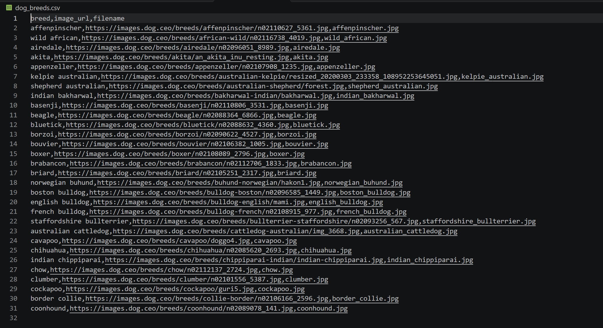
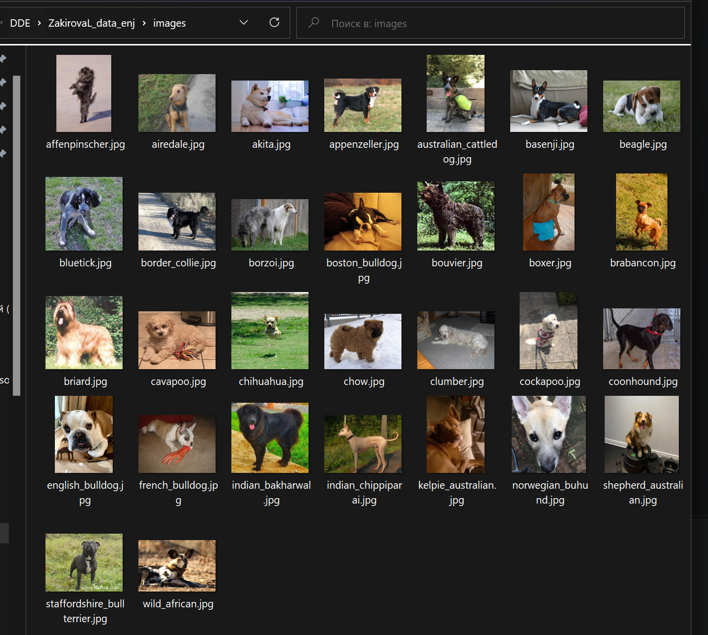

# Сбор данных: Dog API

## Что собрано
- **Породы собак** - 30 записей с полями: breed, image_url, filename
- **Фотографии** - 30 изображений в папке `images/`

## Источник
- **API:** [Dog API](https://dog.ceo/dog-api/)
- **Документация:** [https://dog.ceo/dog-api/documentation/](https://dog.ceo/dog-api/documentation/)
- **Авторизация:** не требуется
- **Лицензия:** открытая коллекция, бесплатно

## Эндпоинты
| Метод | URL | Описание |
|-------|-----|----------|
| GET | /breeds/list/all | Список всех пород |
| GET | /breed/{breed}/images/random | Случайное фото породы |

## Как запустить
```bash
pip install -r requirements.txt
python scripts/read_api.py
```

##  Результат
### Метаданные (первые 10 строк)


### Скачанные фотографии

